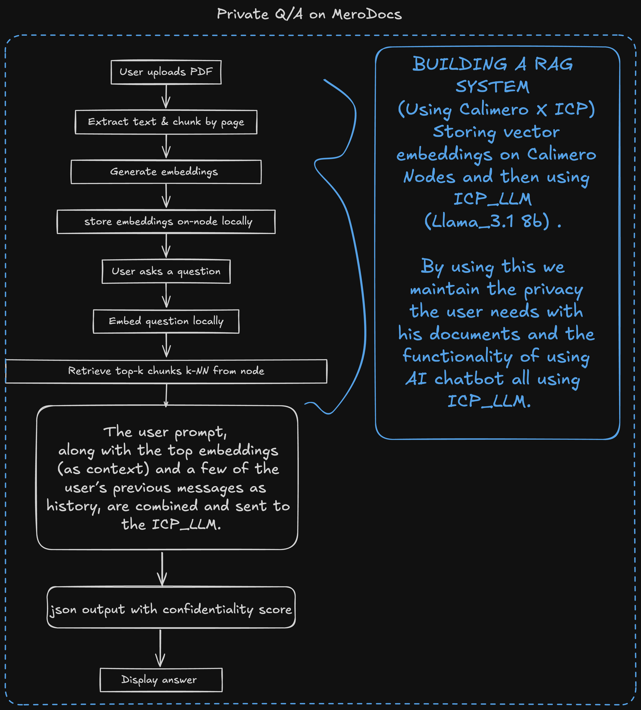

# MeroSign

**MeroSign** is a privacy-first e-signature app on **Calimero**: upload a PDF,
collect signatures from the members of your organization, and keep every signed
version.

A component app on Calimero 1.0: the contract is on core's component SDK
(`calimero-app-sdk`, `wasm32-wasip2`), the PDFs and signature images are the
app's blobs, local development runs on `merod local`, and the frontend talks to
the local nodes in development and to Calimero Cloud in production through
mero-js's `CalimeroClient` (`@calimero-apps/connect`). See
[`docs/COMPONENT-APPS.md`](../../docs/COMPONENT-APPS.md).

| | |
|---|---|
| `logic/` | the contract (a standalone crate: its own `[workspace]` and `Cargo.lock`) |
| `logic/tests/` | `harness.rs` (every method on core's wasmtime engine, `TestApp`), `scenarios.rs` (every `scenarios/*.json`) |
| `logic/scenarios/` | `signing.json` (v1's merobox workflow, extended to the whole signing flow), `library.json` (the private library), `access.json` (the org's gate, guests, roles, the wire); run by `cargo test` and on `merod local` |
| `app/` | Vite + React frontend |
| `mobile/` | native iOS and Android apps, **still v1** (see [Mobile](#mobile)) |

> **Blobs need the next core release.** Uploading a PDF or a signature image is
> `POST /apps/{app}/blobs`. Core `1.0.0-rc.7` (this repo's `component-core-tag`)
> answers that route with `409 NOT_SUPPORTED` for a component app: component
> blobs are core#4815, merged after rc.7 and not in a release yet. Until the pin
> moves, everything that does not upload works on `merod local` (workspaces,
> agreements, participants, roles, consents, the signature-status flow driven
> by the scenarios), and an upload shows the node's message. See
> [Blobs](#blobs).

## The model

| | Calimero 1.0 | v1 |
|---|---|---|
| a workspace | an organization | a namespace |
| an agreement | an instance of this app in the workspace's org, set up shared (`setup(false, name)`) | a shared context in the namespace |
| your signature library | your own instance of this app, no org, set up private (`setup(true, "default")`) | your private "default" context |
| a PDF or a signature image | a blob of the instance (`POST /apps/{app}/blobs`), its id in the contract | a blob announced to the context |
| joining | an org invite link, redeemed after a passkey sign-in, then `registerSelfAsParticipant` | a namespace invitation, joining the context, waiting for it to sync |
| who you are | an account, signed in with a passkey | a node identity (an account and a device key), signed in through the node |

Every member of a workspace (owner, admins, members, guests) reaches every
agreement in it. Anyone else is refused before the contract runs
(`404 NOT_FOUND` for an outsider, `401 UNAUTHENTICATED` for an anonymous caller).
Inside an agreement the contract's own roster decides:

| Level | What it allows |
| --- | --- |
| `Read` | Read the agreement and its documents. |
| `Sign` | Upload documents and sign them. What joining gives a member of the org. |
| `Admin` | Everything a signer can do, plus deleting documents and managing participants. |

The agreement's creator is its first `Admin`. An admin adds an account of the
organization at any level, changes anyone's level, or removes them (a removed
account cannot register itself again); the last admin cannot step down or be
removed. A guest of the organization can read, and joins only when an admin adds
them.

### Signing

A signature is recorded for the **caller's account**: `signDocument`,
`setConsent` and `markParticipantSigned` take only the document. To sign you
hold `Sign` or `Admin` and have consented to that document yourself. A document
names who must sign it at upload (every participant at `Sign` or above then) and
becomes `FullySigned` once all of them have; that is terminal.

**Nothing is overwritten.** A signature is a new PDF: the signer downloads the
current version, flattens their mark into it in the browser, uploads it as a new
blob, and records it from `baseHash` to `newHash`. The document's current version
is the last signature's; every signed version stays on record. A `baseHash` that
is no longer current (someone signed in between) is refused, and the signer
reopens and signs again.

### Signature library and the legal assistant

Your signature library is your own private instance: draw a signature, keep it,
reuse it. An uploaded PDF can carry embeddings of its text, computed in the
browser; `searchDocumentByEmbedding` answers the assistant's questions from them.

<p align="center">
  
</p>
<p align="center">
  
</p>

## Run it

```bash
rustup target add wasm32-wasip2
# merod at component-core-tag (root Cargo.toml), once: see docs/COMPONENT-APPS.md
pnpm dev:local mero-sign     # merod local + the contract + the app on http://localhost:5173/
```

Sign up with a passkey, create a workspace and an agreement in it. To try a
second person, open the workspace's invite link in another browser profile.

## Test it

```bash
M=tools/component-bundle/Cargo.toml
cargo fmt --manifest-path apps/mero-sign/logic/Cargo.toml -- --check
cargo clippy --manifest-path apps/mero-sign/logic/Cargo.toml --all-targets -- -D warnings
cargo clippy --manifest-path apps/mero-sign/logic/Cargo.toml --target wasm32-wasip2 -- -D warnings
cargo test --manifest-path apps/mero-sign/logic/Cargo.toml       # harness + scenarios
cargo run --release --manifest-path $M -- build apps/mero-sign/logic   # res/abi.json
pnpm merod-local e2e mero-sign                                   # the scenarios on merod local
pnpm -F mero-sign lint && pnpm -F mero-sign typecheck && pnpm -F mero-sign test && pnpm -F mero-sign build
```

## What changed in the port, and why

The component runtime runs the app on its cluster's leader, which applies every
write in one replicated log. So the state is plain maps, and the CRDT defences
v1 needed (the `lww_take` tie-break, `Mergeable` rules, per-owner keys and the
"lowest holder" pick, write-once entries, resolving two signatures built on the
same version) have nothing left to decide.

### Storage

| v1 (`calimero-storage`) | component SDK |
|---|---|
| `Frozen<bool>`, `Frozen<UserId>`, `Frozen<String>` from `init(is_private, context_name)` | `info: Cell<Info>` (`isPrivate`, `contextName`, `owner`, `createdAt`), written once by `setup` |
| `signatures: UnorderedMap<String, SignatureRecord>` | `signatures: UnorderedMap<u64, SignatureRecord>` |
| `joined_contexts`, `identity_mappings`: `UnorderedMap<String, …>` | the same maps, keyed by the agreement's app id |
| `roles: AccessControl` (admin tier, `signer`/`viewer`/`removed` roles) + `joined: UserStorage` | `participants: UnorderedMap<account, PermissionLevel>`, `admins: Set`, `removed: Set` |
| `documents: ModeratedOnce<UnorderedMap<String, StoredDocument>>`, search content inside the document | `documents: UnorderedMap<id, StoredDocument>` (with its `original` and `current` version); embeddings and text in `documentContent`, chunks in `documentChunks: UnorderedMap<(id, position), DocumentChunk>` |
| `document_signatures: WriteOnce<SortedMap<"{doc}/{signer}/{nonce}", SignedVersion>>`, the chain rebuilt on every read | `documentSignatures: UnorderedMap<(doc, position), SignedVersion>`, appended in order |
| `consents: UserStorage<Consents>` | `consents: UnorderedMap<(doc, account), bool>` |

The write rules v1 kept in storage types are checks in each method against
`env::caller()`. v1's forged-write tests (a signature written under another's
name, a self-granted admin, an edited signature) are the same calls made as
another account, in `tests/harness.rs` and `scenarios/access.json`.

### Blobs

The contract stores a blob's id (64 lowercase hex digits, its SHA-256) and never
reads the bytes, as in v1. What moved is where the bytes go:

- **Upload and download** are the app's blob routes (`client.uploadBlob(app,
  bytes)`, `client.downloadBlob(app, id)`), per instance: a signature image is a
  blob of your library, a PDF and each signed version a blob of the agreement.
- **No announce.** v1 called `blob_announce_to_context` on every upload (a
  prefetch hint); a 1.0 cluster stores a blob on a majority of its nodes at
  upload, so there is nothing to announce.
- **rc.7 refuses component blobs** (`409 NOT_SUPPORTED`); core#4815 adds them
  after rc.7. It also adds `BlobRef`, a typed reference the host counts: a blob
  no stored value refers to is forgotten an hour after upload. **When
  `component-core-tag` moves past #4815, change the stored blob ids
  (`SignatureRecord.blobId`, `Version.pdfBlobId`, `SignedVersion.pdfBlobId`) to
  `BlobRef`**, or the cluster will drop every PDF an hour after it is uploaded.
  Its JSON form is the same hex id, so no client changes.

### What a client sees

| | v1 | now |
|---|---|---|
| creating an instance | `init(is_private, context_name)` | `init()` takes no arguments; the owner then calls `setup(isPrivate, contextName)`, once (`Conflict` after). Before it every method but `setup` and `isDefaultPrivateContext` answers `Invalid` |
| method names | `upload_document`, `sign_document`, … | the same methods, camelCase: `uploadDocument`, `signDocument`, … |
| argument names | `pdf_blob_id_str`, `user_id_str`, `context_id_str`, … | camelCase, otherwise the same: `pdfBlobIdStr`, `userIdStr`, `contextIdStr`, … |
| accounts (`uploaded_by`, `signer`, `user_id`, `owner`, `whoami`, `listParticipants`, …) | 32-byte arrays (JSON arrays of numbers) | account id strings |
| blob ids (`pdf_blob_id`, `blob_id`) | 32-byte arrays | 64 lowercase hex digits; an argument that is not 64 hex digits is `Invalid` (upper case is accepted and stored lower case) |
| context ids (`getContextId`, `contextIdStr`, `ContextMetadata.context_id`) | 32 bytes, hex in arguments | the agreement's app id, any non-empty string |
| sizes, timestamps, counts, signature ids | JSON numbers | decimal strings (`"1024"`), in arguments too (`fileSize`, `dataSize`, `signatureId`) |
| timestamps | nanoseconds | milliseconds (the log entry's time) |
| answers' field names | snake_case | camelCase (`uploadedBy`, `pdfBlobId`, `requiredSigners`, `permissionLevel`, …) |
| `DocumentChunk.start_position` / `end_position` | `usize` | `startPosition` / `endPosition`, `u32`, still JSON numbers |
| `getContextDetails().created_at` | the time of the read | when the agreement was set up |
| `getContextDetails().participants`, `listParticipants`, `listDocuments`, `listSignatures`, `listJoinedContexts` | every entry | at most 1,000, in key order |
| who reaches an agreement | every member of the context | everyone in the workspace's org (guests included); anonymous `401`, outsiders `404` |
| `registerSelfAsParticipant` | anyone in the context | a member of the org (not a guest: `Forbidden`) |
| `addParticipant` | any public key | an account of the org, guests included (`Invalid` otherwise) |
| private-library methods | any member of the private context | its owner only (`Forbidden`) |
| a signature by someone who was not a required signer and was later demoted below `Sign` | dropped off the document (a CRDT defence) | it stays: it was valid when made |
| two signatures on the same version | both stored, one kept on the document by a fork rule, the other could re-sign | the second is refused (`Conflict`): it re-signs from the new version |
| `deleteDocument` | removed the document | removes the document with its search content, chunks, signatures and consents; its blobs stay in the app until its owner deletes them |
| `setConsent` | in the caller's `UserStorage` | the same rule (the caller's own consent), stored by document |
| `markParticipantSigned` without having signed | `"You have not signed this document yet"` | the same, as `Invalid` |
| search snippets | cut at a byte offset (could panic on a multi-byte character) | cut at a character |
| errors | `FunctionCallError` with a message string | `422 APP_ERROR`: `NotFound { what, id }`, `Forbidden { message }`, `Invalid { message }`, `Conflict { message }`; the messages are v1's |
| events | to every member of the context; fields snake_case, accounts as byte arrays | to everyone the instance reaches (`Audience::All`); camelCase fields, accounts as strings, `SignatureCreated.id`/`size` decimal strings. `ParticipantInvited` (never emitted in v1) is gone |
| migrations | none | none (the component SDK has none yet) |

### Frontend

- `MeroProvider` and the calimero-client login, the node picker and URL, the
  desktop hand-off, `useApplicationId`, the generated `MeroSignClient` and its
  codegen, the bs58/fflate invitation codecs, mero-platform deep links and the
  namespace/context plumbing are gone. The session is `@calimero-apps/connect`
  (`src/session.ts`, `src/sessionContext.tsx`): passkey sign-in or sign-up, the
  session stored per app and per target.
- `src/lib/meroSign.ts` is the typed client and the **one adapter**: it calls
  the contract by its ABI names and turns its answers back into the shapes the
  screens were written against (snake_case, numbers, nanosecond-free), so the
  pages keep their UI. `meroSign.test.ts` checks its method lists and argument
  names against the committed `logic/res/abi.json`.
- `src/lib/agreements.ts`: workspaces are orgs (creating one also lets members
  create agreements and invite, a passkey step-up); agreements are instances in
  the org, then `setup(false, name)`; the library is your own instance
  `mero-sign:library`, no org, `setup(true, "default")`. Opening an agreement
  registers you as a signer if you are not on its roster, and records it in
  your library (`joinSharedContext`).
- Invitations are org invites approved with the inviter's passkey; the link is
  the app's own URL, `?invite=<token>`, plus `&agreement=<app id>` to land in one
  agreement. "Invite one person" now adds an account already in the workspace to
  the roster at a level.
- Blobs go through `client.uploadBlob` / `downloadBlob` on the instance. On rc.7
  the node's `409 NOT_SUPPORTED` is shown as a plain sentence.
- The "Syncing…" states, the TEE badge and the node host in the shell are gone;
  errors show the contract's own message. Display names are org member
  metadata.
- The Playwright suites (journey, shell, landing spec, screenshots, live node
  tests) are removed: the end-to-end run is `pnpm merod-local e2e mero-sign`, and
  the screens are tested with a mocked client (`App.test.tsx`).

## Mobile

`mobile/ios` and `mobile/android` are **unchanged and still v1**: they are built
on the v1 Swift and Kotlin SDKs (`MeroAppSession`: relay, contexts, namespace
invitations) and a client generated from the v1 ABI, and the pinned SDKs have no
1.0 client to port them to yet. They work only against a v1 deployment of the
app until those SDKs speak the 1.0 API. `mobile/scripts/regenerate-client.sh`
refuses the component ABI meanwhile.

## Production

The production frontend is the one bundled into the `.mpk` (`frontend-dir`), so
the cluster serves it from the package's own origin, where passkeys work. Build it
with `VITE_CALIMERO_CLUSTER` and `VITE_CALIMERO_MIN_RELEASE` set (see
`app/.env.example`); without them the production build refuses to connect.
